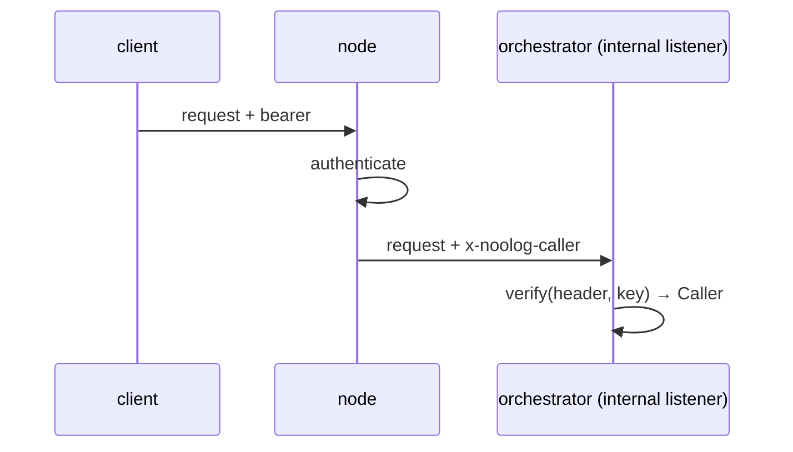

# Caller assertion

`quorum_rs::caller`: how the node tells a service behind it who is calling.

The node authenticates the request, then forwards it with `x-noolog-caller`
set to `sign(&caller, key)`. The service calls `verify(value, key)` and acts
as the returned `Caller`. Both derive `key` from the KMS
(`internal/node-to-orch/v1`), and the header is only honoured on the
service's internal listener.

| Field | Meaning |
|---|---|
| `principal` | who is calling |
| `roles` | e.g. `operator`, `admin` |
| `display_name` | optional |
| `system` | a platform service acting for itself |
| `budget_cap` | optional compute cap |
| `operator_pubkey` | optional signing key |
| `tags` | identity tags the caller's agents inherit |
| `grants` | glob patterns matched against other entities' tags |

Value: `<base64url(json)>.<hex HMAC-SHA256(key, base64url(json))>`, the JSON
holding the fields plus `exp` (unix seconds, 60 s after signing). Refused:
another key, an empty key, a changed payload, an expired assertion.
