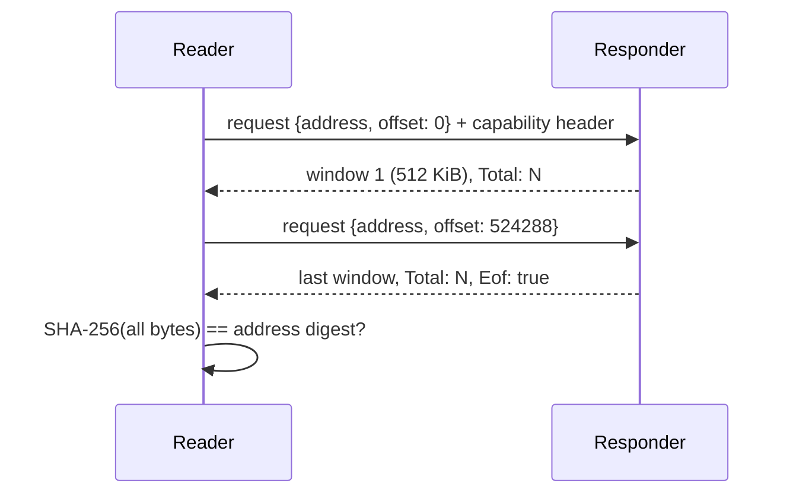

# Content fetch protocol

How a reader obtains the bytes behind a content address, over NATS.
Implemented by `quorum_rs::content::fetch` (reader) and by the orchestrator's
content router (responder).

## Purpose

A proposal may carry a **content address** instead of its answer
(`ProposalType::Uri`), so large answers do not travel inline through every
round. The bytes stay in an object store; only the party holding that
store's credentials, the **responder**, can read it. Every other party
fetches through the responder and verifies what it receives against the
address.

## Terms

| Term | Meaning |
|---|---|
| Content address | `<scheme>://<bucket>/<digest>`: where the bytes are stored, and the SHA-256 of the bytes, lowercase hex. Parsed by `content_address::ContentAddress`. |
| Responder | The process that holds the bucket's credentials and answers requests on a NATS subject (the orchestrator's `content_router`). |
| Subject | Where the responder listens for one job's content: `{prefix}.{job}.get`, default prefix `nsed.content`, `{job}` encoded with `nats_kv_key_encode`. |
| Window | One reply's bytes, at most `WINDOW_BYTES` (512 KiB), so a reply fits the default 1 MiB NATS payload limit. |
| Capability | A token minted by the orchestrator granting a reader access to one job's content. |

## Exchange



The reader sends one request per window, each with `offset` equal to the
bytes received so far, until a reply carries `Eof: true`.

## Request

NATS request on the subject. Body: JSON.

| Field | Type | Meaning |
|---|---|---|
| `address` | string | the content address |
| `offset` | integer, default 0 | first byte wanted |

| Header | Required | Value |
|---|---|---|
| `Nsed-Content-Capability` | when the responder demands one | the capability token (`content::capability_headers`) |

## Reply

Body: raw bytes of the window, empty on a refusal.

| Header | On | Value |
|---|---|---|
| `Nsed-Content-Total` | every reply | size of the whole content in bytes |
| `Nsed-Content-Eof` | the last reply | `true` |
| `Nsed-Content-Error` | a refusal | reason; the body is empty |

## Reader checks

`fetch` fails, returning no content, when:

| Condition | Error |
|---|---|
| `Nsed-Content-Error` present | `responder refused <address>: <reason>` |
| bytes received exceed `Nsed-Content-Total` | `responder served more than the <N> bytes it says <address> holds` |
| empty body without `Eof` | `responder returned no bytes and no end for <address>` |
| SHA-256 of the assembled bytes differs from the digest | `content served for <address> hashes to <h>, so it is not what was named` |

The digest check is what makes the protocol safe over an unauthenticated
subject: a responder, or anyone answering on its subject, cannot substitute
content without the hash failing.

## API

```rust
let bytes = quorum_rs::content::fetch(&client, &subject, &address, Some(&capability)).await?;
```

| Item | Kind |
|---|---|
| `content::fetch(client, subject, address, capability)` | async fn → `Result<Vec<u8>>` |
| `content::ContentRequest` | request body |
| `content::capability_headers(token)` | request headers |
| `WINDOW_BYTES`, `HEADER_TOTAL`, `HEADER_EOF`, `HEADER_ERROR`, `HEADER_CAPABILITY` | constants |

Related: [NATS key codec](nats-key-codec.md) for the `{job}` token in the subject.
