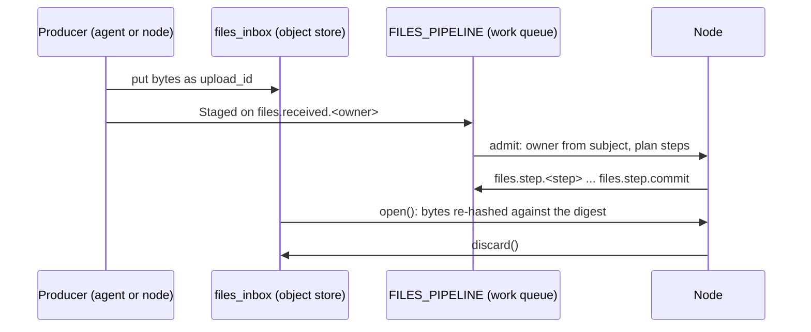

# Files pipeline

`quorum_rs::pipeline`: how an upload travels from its producer to the store
that keeps it, through NATS. Available without default features.



| Item | Meaning |
|---|---|
| `INBOX` | `files_inbox`, the shared object store; objects expire after `INBOX_MAX_AGE` (24 h) |
| `STREAM` | `FILES_PIPELINE`, work queue over `files.received.*` and `files.step.*` |
| `received_subject(owner)` | `files.received.<owner>`; producers' NATS credentials grant only their own operator |
| `step_subject(step)` | `files.step.<step>`; `COMMIT` (`commit`) is always the last step |
| `ensure(js, inbox_max_bytes)` | creates the inbox and stream if missing |
| `stage(js, owner, reader, meta, job)` | puts the bytes, announces a `Staged`; returns the upload id |
| `Staged` | `upload_id`, `owner` (filled by the node), `meta`, `encryption`, `plan`, `derived`, `notes`, `job` |
| `Staged::advance(js)` | drops the step just done, publishes to the next |
| `open(js, staged)` | the staged bytes behind `Verified`, which fails with `InvalidData` at the end unless length and SHA-256 match |
| `open_derived(js, staged, meta)` | one derived object behind `Verified` |
| `Deriving::new(js, staged)` | a `Blob` over the inbox for one upload: what a step writes is a derived object (`derived_name(upload_id, filename)`), `made()` is what to append to `Staged::derived`; takes no notes. Code written against `Blob` (`hls::segment_and_store`) runs on it unchanged |
| `discard(js, staged)` | deletes the source and derived objects; idempotent |
| `derived_name(upload_id, name)` | inbox name of a derived object |

Messages carry ids and metadata, never bytes. Staged objects are plaintext
(`Encryption::None`) until steps run in attested enclaves with released keys;
the inbox is readable by every producer until per-operator NATS tenancy.

## Jobs

An upload may carry a `JobRequest`, a deliberation to run on the file once
stored, under the uploader's identity and budget:

| Field | Meaning |
|---|---|
| `policy` | `quorum_rs::scheduling::PolicyConfig` |
| `query` | the task for the agents |
| `variables` | passed to the seats |
| `grant` | `JobGrant { public_key, expires_at, signature }` |

The grant is the uploader's nkey user key signature (lowercase hex, as
orchestrator challenges are signed) over `noolog-files-job-v1\n` and the JSON
of `owner`, `digest`, `policy_id`, `query`, `variables`, `expires_at`. It is a
signature, not a bearer token, because staged messages are readable by every
producer: a stolen grant only runs the job it names, before it expires.

```rust
let job = JobRequest::new(policy, query, variables).sign(&key, owner, &digest, expires_at)?;
pipeline::stage(&js, owner, &mut reader, &meta, Some(job)).await?;
job.verify(owner, &digest, now)?; // whoever runs it
```
